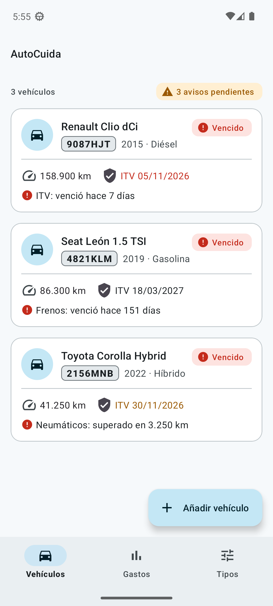
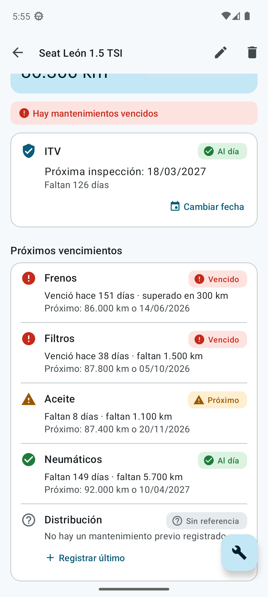
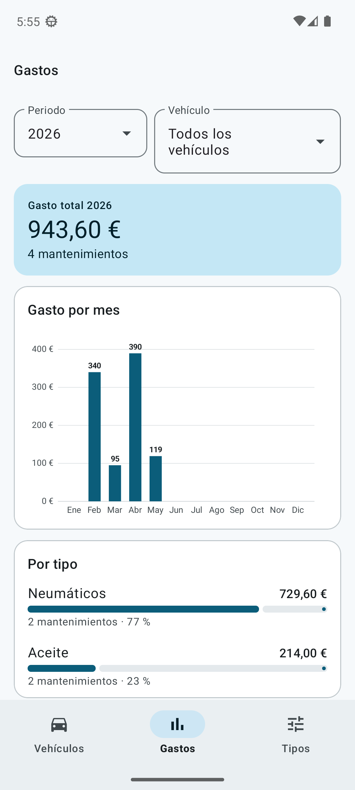
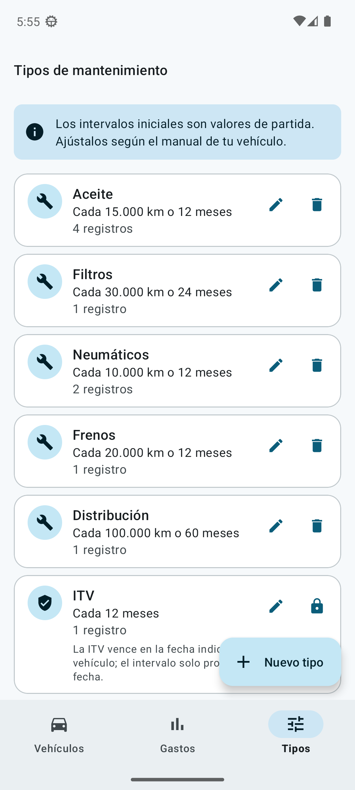
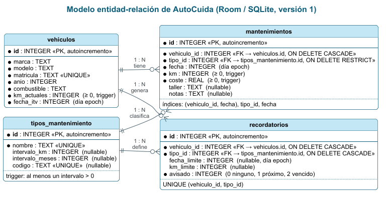

# AutoCuida

Aplicación Android para gestionar el mantenimiento de tus vehículos: historial de revisiones, próximos cambios de aceite, filtros, neumáticos, frenos y distribución, control de la ITV, kilómetros y gastos. Avisa de los vencimientos con notificaciones locales y funciona sin conexión ni cuenta de usuario.

<p align="center">
  
  
  
  
</p>

## Funcionalidades

- **Vehículos**: alta, consulta, edición y borrado (con eliminación en cascada de su historial). Matrícula única y validada.
- **Mantenimientos**: registro, edición y borrado con fecha, kilómetros, coste, taller y notas. Historial por vehículo filtrable por tipo. Validación de coherencia cronológica de los kilómetros.
- **Tipos configurables**: Aceite, Filtros, Neumáticos, Frenos, Distribución e ITV precargados, con intervalos por kilómetros, por meses o ambos. Se pueden crear, editar y eliminar (no se permite borrar tipos con registros).
- **Calculadora de vencimientos**: próximo mantenimiento por kilómetros y por fecha, considerando el que llegue antes. Estados con color, icono y texto:
  - **Verde – Al día**
  - **Ámbar – Próximo**: quedan menos de 1.000 km o menos de 30 días.
  - **Rojo – Vencido**: se ha superado algún límite.
  - **Sin referencia**: no hay un mantenimiento previo; se puede registrar el último conocido.
- **ITV**: fecha editable por vehículo, cuenta atrás, estado y actualización al registrar una inspección.
- **Kilómetros**: actualización con validación de retrocesos y recálculo inmediato de estados y avisos.
- **Notificaciones**: revisión diaria con WorkManager (también con la aplicación cerrada), sin avisos duplicados y con acceso directo al detalle del vehículo. Compatible con el permiso de notificaciones de Android 13+.
- **Gastos**: total del año o de todo el historial, desglose por tipo y por vehículo, gráfica de barras mensual o anual e historial del periodo, con filtro por vehículo.
- **Interfaz adaptable**: tema claro y oscuro, orientación vertical y horizontal (navegación lateral en pantallas anchas).

## Tecnologías

| Ámbito | Tecnología y versión |
|---|---|
| Lenguaje | Kotlin (integrado en Android Gradle Plugin 9.2.0), JVM 17 |
| Interfaz | Vistas XML, ViewBinding, Material Components 1.13.0, ConstraintLayout 2.2.1, RecyclerView 1.4.0 |
| Navegación | Navigation Component 2.9.6 (una actividad y varios fragmentos) |
| Arquitectura | MVVM: Lifecycle/ViewModel 2.10.0, Kotlin Coroutines 1.10.2, Flow |
| Persistencia | SQLite con Room 2.8.4 (runtime, KTX, compilador mediante KSP 2.3.4) |
| Tareas en segundo plano | WorkManager 2.11.2 |
| Gráficas | MPAndroidChart v3.1.0 |
| Pruebas | JUnit 4.13.2, kotlinx-coroutines-test, AndroidX Test (runner 1.7.0, ext-junit 1.3.0), Room Testing, Espresso 3.7.0 |
| Compilación | Gradle 9.4.1, compileSdk 36.1, targetSdk 36, minSdk 26 (Android 8.0) |

## Arquitectura

```
com.autocuida.app
├── data
│   ├── entity       Entidades Room y clases de consulta
│   ├── dao          VehiculoDao, TipoMantenimientoDao, MantenimientoDao, RecordatorioDao
│   ├── db           AppDatabase, precarga de tipos y triggers de integridad
│   └── repository   Repositorios por dominio y sincronización de recordatorios
├── domain           CalculadoraMantenimiento, EvaluadorAvisos, validadores (sin dependencias de Android)
├── ui
│   ├── vehiculos    Lista, formulario, detalle y actualización de kilómetros
│   ├── mantenimiento Formulario e historial
│   ├── gastos       Estadísticas y gráfica
│   ├── tipos        Tipos de mantenimiento
│   └── comun        Estados visuales, eventos y utilidades de fragmentos
├── worker           Revisión diaria de vencimientos (WorkManager)
└── util             Fechas, formatos, textos de vencimiento y notificaciones
```

Diagramas en [`documentacion/diagramas`](documentacion/diagramas): entidad-relación, casos de uso, clases, navegación, arquitectura, secuencia y Gantt.

<p align="center"></p>

## Requisitos

- **Para usar la aplicación**: Android 8.0 (API 26) o superior. El APK de la versión release ocupa 2,4 MB.
- **Para compilar**: Android Studio (el proyecto se ha compilado con el JDK y el SDK de Android Studio 2025.3, compilación 253.32098.37), JDK 17 o superior (se usa el JBR 21 incluido en Android Studio) y Android SDK Platform 36.1.

## Instalación del APK

1. Descarga el archivo APK de la sección *Releases* del repositorio.
2. Abre el archivo en el teléfono. Si Android lo solicita, permite la instalación de aplicaciones desde esa fuente.
3. Pulsa **Instalar** y, al terminar, **Abrir**.
4. En Android 13 o superior, acepta el permiso de notificaciones para recibir los avisos.

El manual de instalación completo está en [`documentacion/manual_instalacion`](documentacion/manual_instalacion).

## Compilación y ejecución

```bash
git clone <url-del-repositorio>
cd AutoCuida
```

Abre la carpeta en Android Studio, espera a que termine la sincronización de Gradle y ejecuta la configuración `app` en un emulador o dispositivo. Desde la línea de comandos:

```bash
./gradlew assembleDebug          # APK de depuración en app/build/outputs/apk/debug
./gradlew installDebug           # instala en el dispositivo conectado
```

### Versión firmada

Crea un archivo `keystore.properties` en la raíz (no se versiona) con:

```properties
storeFile=ruta/al/almacen.jks
storePassword=...
keyAlias=...
keyPassword=...
```

Después ejecuta `./gradlew assembleRelease`. Sin ese archivo se genera un APK release sin firmar.

## Pruebas

```bash
./gradlew testDebugUnitTest              # 58 pruebas unitarias (JUnit 4)
./gradlew connectedDebugAndroidTest      # 38 pruebas de integración y de interfaz (requiere emulador o dispositivo)
./gradlew lintDebug                      # análisis estático
```

Resultados de la última ejecución (12/11/2026):

| Conjunto | Entorno | Resultado |
|---|---|---|
| Unitarias (calculadora, avisos, validadores, planificador) | JVM | 58 / 58 superadas |
| Integración Room + prueba Espresso del flujo principal | Emulador Pixel 6, Android 13 (API 33) | 38 / 38 superadas |
| Integración Room + prueba Espresso del flujo principal | Emulador Android 8.0 (API 26) | 38 / 38 superadas |
| Lint | — | 0 errores |

Los informes se guardan en [`pruebas`](pruebas).

## Estructura del repositorio

```
AutoCuida/
├── app/                    Proyecto Android
├── capturas/               Capturas reales de la aplicación
├── documentacion/          Informe técnico, diagramas, mockups, manuales, bibliografía y diario
├── presentacion/           Presentación y notas de exposición
├── pruebas/                Informes de pruebas y de Lint
└── video/                  Guion y configuración de grabación
```

## Licencia y datos

AutoCuida guarda toda la información en el propio dispositivo. No requiere cuenta, no usa servidores externos ni permiso de Internet. El único permiso que se pide al usuario es el de notificaciones; WorkManager añade de forma automática `WAKE_LOCK` y `RECEIVE_BOOT_COMPLETED` para programar la revisión diaria. Los intervalos de mantenimiento precargados son valores de partida configurables, no recomendaciones del fabricante.
